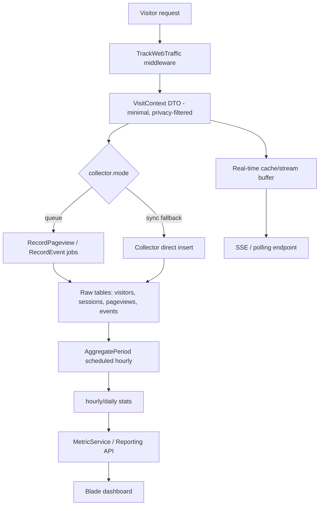

# Laravel Web Analytics — Architecture

> This file began as the v3.0 architecture blueprint. The original audit is preserved below as a historical baseline; the current implementation is summarised first.

**Current branch:** `dev` @ `9319c5f` (2026-11-26) · **Released:** `v3.3.0` · **Preview:** v3.4 replay/heatmaps on `dev`
**Companion documents:** `CHANGELOG.md`, `UPGRADE.md`, and the external v3.2–v4.0 blueprint / gap analysis.
**Audience:** maintainers and contributors

---

## 0. Current-state addendum (v3.3.0 + v3.4 preview)

### Runtime and storage

- PHP `^8.2 || ^8.3 || ^8.4 || ^8.5`; Laravel `^11 || ^12 || ^13`.
- SQLite, MySQL 8 (`ONLY_FULL_GROUP_BY`) and PostgreSQL 16 run the same 194-test / 995-assertion suite.
- All analytics are stored in `lwa_*` tables: `lwa_logs`, `lwa_websites`, `lwa_visitors`, `lwa_sessions`, `lwa_pageviews`, `lwa_events`, rollups, `lwa_api_tokens`, `lwa_profiles`, `lwa_identity_aliases`, `lwa_dead_letters`, `lwa_insights`, `lwa_dashboards`.
- The v3.4 preview adds `lwa_replay_sessions`, `lwa_replay_chunks`, `lwa_replay_markers` and `lwa_replay_assets`. Chunk bytes live on a Laravel disk; the tables are only an index.

### Released v3.3 product analytics

- `EventStore` is the single bounded read path. Trends, Funnels, Retention and Paths each cap scans at 20,000 most recent matching events and ship their definitions with every response.
- Saved reports are DB-backed in website/tenant-scoped `lwa_insights`, never localStorage.
- Dashboard insight widgets resolve saved reports in `DashboardInsights` and follow the dashboard time window; at most 12 are computed per page.
- The sidebar has 20 default links: Overview, Real-time, Logs, Dashboards, Visitors, Traffic Sources, Pages & Screens, Geography, Devices & Browsers, Campaigns, Funnels, Retention, User Paths, Trends, Event Explorer, Events & Goals, Conversions, Performance, Error Monitoring and Settings.

### Unreleased v3.4 replay and heatmaps (`dev`)

- `@lwaReplay` emits an expiring HMAC-signed config plus a deferred build-free recorder. Consent is separate from analytics consent; guests are excluded by default; all input values and `[data-lwa-mask]` nodes are removed before upload.
- `POST /web-analytics/api/v1/replay/chunks` authenticates with the signed token only and stores chunks verbatim. Website/tenant scope comes from the signature, never client input.
- `/web-analytics/replay`, `/web-analytics/replay/{id}`, gated manifest/chunk routes and `/web-analytics/heatmaps` all re-check the configurable `viewLwaReplay` gate and session scope on every request.
- `HeatmapService` aggregates at most 20,000 most recent scoped markers in PHP: 2.5% click buckets, 10% scroll-depth bands, top targets, rage clicks (3 clicks within 1 s) and dead clicks (no different marker within 2 s).
- `lwa:replay:prune` enforces the default 30-day replay retention.
- Two optional sidebar links (Session Replay, Heatmaps) appear only when replay is enabled and the gate allows them.

No paid tier, activation server, feature lock or mandatory third-party service exists.

---

## 1. Executive summary

The current package is a **single-table, request-level analytics tracker** with a polished multi-page dashboard, privacy controls, and real-time SSE. It is *not* yet a session/event analytics platform.

v3.0 requires a **data-model-first rewrite of the collection and reporting layer**. The UI, routes, privacy controls, and test harness already provide a usable foundation; they should be preserved and extended, not replaced.

The single most important rule for v3:

> **Never make dashboard queries scan raw request rows, and never fabricate a metric that the collector cannot support.**

This blueprint defines the current state, target architecture, schema, migration path, and implementation order.

---

## 2. Current-state audit (`dev` @ `d1acd7b`)

### 2.1 Package metadata

| Item | Current value |
|---|---|
| PHP | `^8.1 \|\| ^8.2 \|\| ^8.3 \|\| ^8.4 \|\| ^8.5` |
| Laravel (illuminate) | `^9.0 \|\| ^10.0 \|\| ^11.0 \|\| ^12.0 \|\| ^13.0` |
| Required components | `support`, `database`, `routing`, `http`, `cache` |
| Optional (`suggest`) | `maxmind-db/reader` |
| Dev dependencies | Orchestra Testbench `^8–^11`, PHPUnit `^10.5–^13` |
| Auto-discovery | `WebAnalyticsServiceProvider` |

> v3 target baseline (decision §9): **PHP 8.2+, Laravel 11+**. The table above records the *current v2* constraints; the drop is a deliberate major-version change.

### 2.2 Database schema — `lwa_logs` (only analytics table in the v3.0 audit baseline)

| Column | Type | Index | Notes |
|---|---|---|---|
| `id` | bigint PK | — | |
| `ip_address` | varchar(45) nullable | ✅ | anonymizable |
| `session_id` | varchar(100) nullable | ✅ | `u_`, `s_` or `f_` prefixed |
| `tenant_id` | varchar(100) nullable | ✅ | added by second migration |
| `user_id` | varchar(64) nullable | ✅ | string to support UUID keys |
| `method` | varchar(10) default GET | — | |
| `path`, `full_url` | text nullable | — | |
| `status_code` | int default 200 | ✅ | |
| `response_time_ms` | decimal(10,2) | — | |
| `bytes_sent` | bigint | — | |
| `country`, `city` | varchar nullable | country ✅ | |
| `device`, `os`, `browser` | varchar(50) nullable | ✅ | |
| `user_agent`, `referrer` | text nullable | — | |
| `utm_source`, `utm_medium`, `utm_campaign` | varchar(100) nullable | ✅ | added by third migration |
| `created_at`, `updated_at` | timestamps | created_at ✅ | |

Migrations are **auto-loaded** by the service provider (not published). The three migration files are guarded with `hasTable` / `hasColumn` checks.

**Observation:** one row = one HTTP request. There is no visitor entity, no session lifecycle, no event entity, and no aggregate table.

> Later (post-v3.0) additive migrations add nullable `host` and `cache_status` columns to `lwa_logs`; `host` is backfilled from `full_url`, and `cache_status` is normalised from CDN cache headers. §2.2 is the historical audit snapshot and does not list those columns.

### 2.3 Routes (current)

- Dashboard/data/stream/export: `lwa_dashboard`, `lwa_index`, `lwa_data`, `lwa_stream`, `lwa_export`
- Settings actions: `lwa_settings_prune`, `lwa_settings_empty`, `lwa_settings_test_alert`
- 13 section URLs in the **v3.0 audit baseline**: `lwa_overview`, `lwa_realtime`, `lwa_visitors`, `lwa_sources`, `lwa_pages`, `lwa_geography`, `lwa_devices`, `lwa_campaigns`, `lwa_events`, `lwa_conversions`, `lwa_performance`, `lwa_errors`, `lwa_settings`. The current 20-link sidebar is listed in §0 above.

All inherit `['web', 'auth']` by default. Tenant scoping ignores client-supplied `?tenant_id=` / `X-Tenant-ID` unless an opt-in authorizer is configured.

### 2.4 Source layout

```
src/
├── WebAnalyticsServiceProvider.php
├── Http/
│   ├── Controllers/WebAnalyticsController.php
│   └── Middleware/TrackWebTraffic.php
├── Models/LwaLogs.php
├── Mail/WeeklySummaryMail.php
├── Commands/  (prune, export, simulate, summary)
└── Services/
    ├── DatabaseTrafficAnalytics.php      # all reporting queries
    ├── WebAnalyticsLogParser.php         # file-log fallback source
    ├── TenantResolver.php
    ├── PruneService.php
    ├── AlertService.php
    ├── GeoIpService.php                  # '', ip-api, maxmind
    ├── BotDetector.php
    ├── IpAddress.php
    └── CountryFlag.php
```

### 2.5 Views

- `layouts/app.blade.php` — shared shell
- `pages/*.blade.php` — 13 route-specific pages
- `sections/*.blade.php` — content-only partials
- `partials/*`, `mail/weekly-summary.blade.php`
- `dashboard.blade.php` — legacy alias rendering Overview

Design system: Tailwind Play CDN, ApexCharts, Lucide, CSS variables (`--lwa-*`), `[data-theme="dark"]`, Inter, collapsible sidebar, 12 languages, full IANA timezone list.

### 2.6 Tests & CI

- 4 test files, **48 tests / 185 assertions**
- Testbench + SQLite in-memory by default
- CI matrix: **SQLite / MySQL 8 / PostgreSQL 16**, plus PHP 8.1/8.2/8.3/8.5 syntax lint
- Verified locally on SQLite and a real MySQL 8 instance

### 2.7 Current metric definitions (important)

These are **derived approximations** from `lwa_logs` and must be documented as such:

| Metric | Current implementation |
|---|---|
| Total Visitors | `COUNT(DISTINCT ip_address)` |
| Unique Visitors | `COUNT(DISTINCT COALESCE(session_id, ip_address))` |
| Sessions | `COUNT(DISTINCT session_id)` |
| Pageviews | `GET` requests to non-`api/*` paths |
| Bounce Rate | % of session IDs with exactly **one** request |
| Avg Engagement | mean `MAX(created_at) - MIN(created_at)` per session |
| Live Visitors | distinct visitor key within configurable window |

**Risk:** `session_id` is a tracking identifier, not a persisted session with start/end state. Bounce and engagement will be wrong for cross-day or long-idle sessions.

### 2.8 What already satisfies roadmap items

Privacy (DNT, cookieless fingerprint, IP anonymization, bot filtering, tenant isolation, secure SSE), real-time basics (short-lived SSE, `Last-Event-ID`, retry, polling fallback, MaxMind map), 13 route-based pages, CSV export, prune/export/summary commands, multi-DB CI.

---

## 3. Gap analysis (roadmap → current → risk)

| Roadmap phase | Current | Gap | Effort | Risk |
|---|---|---|---|---|
| 1. Analytics engine | Derived metrics | No session lifecycle, landing/exit pages, page title, UTM term/content | **High** | **High** — wrong metrics if rushed |
| 2. Real-time 2.0 | Core live feed + map | Real-time source/device/error widgets | Medium | Low |
| 3. Dashboard | 13 pages, themes, states | Compare period, custom widgets | Medium | Low |
| 4. Multi-website | Tenant support only | Website registry, per-site config/tokens/retention, switcher | **High** | **High** — isolation must be from day 1 |
| 5. Reporting/conversion | CSV + summary | Events, goals, funnels, custom/PDF reports | **High** | Medium |
| 6. Performance | Indexes, chunked export | Queue, bulk insert, rollups, query cache, pagination | **High** | **High** — core scalability |
| 7. Security/privacy | Most basics | URL masking, API tokens, rate limits, event payload limits | Medium | High if delayed |
| 8. DX | Middleware + commands | Facade, REST API, webhook system, storage driver contract | Medium | Low |

---

## 4. Target architecture

### 4.1 Principles

1. **Raw events and reporting data are separate.**
2. **Collection is asynchronous by default, synchronous only as fallback.**
3. **Every query is website-scoped through a global scope.**
4. **Metrics have written definitions and unit tests.**
5. **Every v3 feature is feature-flagged; existing installs keep working.**
6. **`lwa_logs` is never dropped or rewritten automatically.**

### 4.2 Proposed folder structure (additive)

```
src/
├── Contracts/
│   ├── Collector.php
│   ├── StorageDriver.php
│   └── MetricCalculator.php
├── Data/                         # DTOs: VisitContext, PageviewData, EventData
├── Models/
│   ├── Website.php
│   ├── Visitor.php
│   ├── Session.php
│   ├── Pageview.php
│   ├── AnalyticEvent.php
│   ├── HourlyStat.php
│   └── DailyStat.php
├── Jobs/
│   ├── RecordPageview.php
│   ├── RecordEvent.php
│   └── AggregatePeriod.php
├── Services/
│   ├── AnalyticsCollector.php
│   ├── SessionResolver.php
│   ├── MetricService.php         # reads aggregate tables only
│   ├── WebsiteResolver.php
│   ├── EventValidator.php
│   └── ReportExporter.php
├── Http/
│   ├── Middleware/TrackWebTraffic.php   # thin: builds DTO + dispatches
│   ├── Controllers/Api/AnalyticsApiController.php
│   └── Resources/...
├── Facades/Analytics.php
└── Console/Commands/
    ├── UpgradeV3Command.php
    └── BackfillAggregatesCommand.php
```

Existing `DatabaseTrafficAnalytics`, `TenantResolver`, `AlertService`, `GeoIpService`, `BotDetector`, etc. are retained as compatibility layers during v3 alpha/beta.

### 4.3 Proposed data model (ER)

```mermaid
erDiagram
    WEBSITE ||--o{ VISITOR : has
    WEBSITE ||--o{ SESSION : has
    WEBSITE ||--o{ PAGEVIEW : has
    WEBSITE ||--o{ EVENT : has
    WEBSITE ||--o{ HOURLY_STAT : has
    WEBSITE ||--o{ DAILY_STAT : has
    VISITOR ||--o{ SESSION : starts
    SESSION ||--o{ PAGEVIEW : contains
    SESSION ||--o{ EVENT : contains

    WEBSITE {
        bigint id PK
        string name
        string domain
        string tracking_id UK
        string tenant_id nullable
        int retention_days nullable
        json config
    }
    VISITOR {
        bigint id PK
        bigint website_id FK
        string visitor_hash
        timestamp first_seen_at
        timestamp last_seen_at
        string country_code
        string city
        string device
        string browser
        string os
    }
    SESSION {
        bigint id PK
        bigint website_id FK
        bigint visitor_id FK
        string session_key UK
        timestamp started_at
        timestamp ended_at
        string landing_path
        string exit_path
        int pageviews_count
        int duration_seconds
        boolean is_bounce
        string referrer
        string utm_source
        string utm_medium
        string utm_campaign
    }
    PAGEVIEW {
        bigint id PK
        bigint website_id FK
        bigint session_id FK
        string path
        string title
        int status_code
        decimal response_time_ms
        bigint bytes_sent
        timestamp created_at
    }
    EVENT {
        bigint id PK
        bigint website_id FK
        bigint session_id FK
        string name
        json properties
        decimal value nullable
        timestamp created_at
    }
    HOURLY_STAT {
        bigint id PK
        bigint website_id FK
        timestamp bucket_at
        int visitors
        int sessions
        int pageviews
        int bounces
        int engagement_seconds
        bigint bytes
        int errors_4xx
        int errors_5xx
        decimal avg_response_ms
    }
```

`lwa_logs` remains as the **legacy request log** for existing installations. v3 reads it only during upgrade/backfill.

### 4.4 Metric definitions (authoritative for v3)

| Metric | Definition |
|---|---|
| Visitor | Unique `visitor_hash` per website; cookie-less salted hash or explicit first-party ID |
| Session | Visitor activity grouped with a **30-minute inactivity timeout**; persisted `started_at` / `ended_at` |
| Pageview | A recorded page view (not API/AJAX/asset requests) |
| Bounce | Session with exactly 1 pageview **and** duration below a configurable threshold |
| Engagement time | Sum of active intervals between consecutive pageviews, capped at the inactivity timeout |
| Landing page | `path` of the session's first pageview |
| Exit page | `path` of the session's last pageview |
| Conversion | Configured goal/event completed within a session; rate = conversions / sessions |

Every definition gets a unit test with boundary cases (cross-day session, idle gap, repeated pageviews, bot traffic).

### 4.5 Collection & processing flow



Notes:
- Queue is **config-driven** (`queue` default on new installs if a queue driver exists; `sync` fallback otherwise).
- Job payloads contain no raw IP by default when privacy mode is enabled.
- Jobs are idempotent using a `request_uuid`.
- Failed jobs retry with backoff and a dead-letter report.

### 4.6 Aggregation & reporting

- Hourly rollup job: `lwa:aggregate --period=hourly`
- Daily rollup job: `lwa:aggregate --period=daily`
- Dashboard reads only `hourly_stats` / `daily_stats` for charts and KPIs.
- Raw tables queried only for "recent activity", exports, and drill-downs, always paginated.
- Cache keys include website + range + timezone + filters; invalidated on rollup completion.

### 4.7 Multi-website model

- `websites` table with unique `tracking_id`.
- Every analytics model uses a `WebsiteScope` global scope.
- `WebsiteResolver` selects the active website from route/header/session — never from an unvalidated query parameter.
- Per-website retention, capture rules, and API tokens.
- Comparison view aggregates across explicitly selected websites only.

### 4.8 API & DX surface

```php
use Nafiur\WebAnalytics\Facades\Analytics;

Analytics::pageview('/products', ['title' => 'Products']);
Analytics::event('purchase', ['order_id' => 1001, 'amount' => 1500]);
Analytics::goal('registration');
Analytics::summary('30d');
```

REST API (planned): `/api/lwa/v1/websites`, `/summary`, `/timeseries`, `/breakdowns`, `/events`, `/export` — token auth with abilities (`read`, `export`, `admin`) and rotation.

### 4.9 Real-time architecture

- SSE endpoint remains short-lived with `retry:` + `Last-Event-ID`.
- Real-time data comes from a small cache/stream buffer, not raw tables.
- Polling fallback stays for restricted hosting.
- Every stream connection is website/tenant authorized.
- Connection states remain explicit; no fabricated "live" counters.

---

## 5. Migration & retention plan

### 5.1 Rules

1. Do **not** drop, rename, or rewrite `lwa_logs` automatically.
2. Add all v3 tables through new migrations.
3. Provide `php artisan lwa:v3:upgrade --dry-run` first.
4. Backfill in chunks with a checkpoint table; idempotent and resumable.
5. Keep config aliases for v2 keys.
6. Deprecate `lwa_logs` only after two minor releases and a documented archive step.

### 5.2 Upgrade command outline

```
lwa:v3:upgrade
  --dry-run
  --chunk=1000
  --website-domain=example.com
  --since=2026-01-01
  --prune-legacy
```

Steps: create default website from host/config → hash legacy IPs into visitor records → rebuild approximate sessions → insert pageviews → build hourly/daily aggregates → verify counts → write report → optional archive.

### 5.3 Retention

- Raw pageviews/events: configurable per website (default 90 days).
- Hourly stats: 13 months.
- Daily stats: indefinite.
- `lwa_logs`: unchanged until explicit opt-in purge.

---

## 6. Security & privacy review

| Area | v3 requirement |
|---|---|
| IP / cookies | Anonymization + cookie-less hashing default; no new cookies |
| DNT | Skip collection when `DNT: 1` |
| URL privacy | Mask configured query params (`token`, `password`, `email`, …) before storage |
| Events | Property whitelist, key/value size limits, no PII by default |
| SSE | Auth + website scope; no public streams |
| API | Token abilities, rotation, rate limiting |
| Export | CSV injection sanitization; redact IP/visitor refs by default |
| Isolation | Global website/tenant scope tested in every query |
| Deletion | Documented per-website data deletion and retention jobs |

> Privacy behavior must be documented factually. Do not claim legal compliance without a deployment-specific review.

---

## 7. Testing strategy

- Unit tests for every metric definition and boundary case.
- Feature tests for tracking, queue dispatch, aggregate jobs, API auth, isolation, exports.
- Upgrade tests using representative v2 `lwa_logs` fixtures.
- 3-database CI: SQLite, MySQL 8, PostgreSQL 16 (already in place).
- Benchmarks: 1M raw rows dashboard query time, export memory, queue throughput.
- Load/concurrency tests for collector and SSE endpoints.
- Failure tests: queue down, DB unavailable, malformed event payload.

Definition of done = roadmap §7 checklist all ticked.

---

## 8. Implementation order (adjusted to current state)

| # | Work item | Depends on | Milestone |
|---|---|---|---|
| 1 | Freeze terminology + contracts | — | alpha.1 |
| 2 | New schema + website/visitor/session models | 1 | alpha.1 |
| 3 | Collector DTO + queue jobs + sync fallback | 2 | alpha.2 |
| 4 | SessionResolver + pageview recording | 3 | alpha.2 |
| 5 | Event validation + goal tracking | 3 | alpha.3 |
| 6 | Aggregation jobs + MetricService | 4,5 | beta.1 |
| 7 | Reporting API + facade + export | 6 | beta.1 |
| 8 | Dashboard widgets on aggregate data | 7 | beta.1 |
| 9 | Real-time 2.0 widgets + SSE hardening | 6 | beta.2 |
| 10 | Multi-website management + isolation | 2 | beta.3 |
| 11 | Security hardening (tokens, masking, limits) | 10 | rc.1 |
| 12 | Upgrade command + 3-DB/upgrade/benchmark tests | all | rc.1 → stable |

---

## 9. Architectural decisions (confirmed — best practice)

| # | Decision | Choice | Rationale |
|---|---|---|---|
| 1 | Website vs Tenant | **Separate layers.** `tenant` = organisation, `website` = child property/domain. `websites.tenant_id` nullable; all analytics queries scoped by both. | Conflating them makes multi-site reporting impossible later. |
| 2 | Queue driver | **Any Laravel queue; Redis optional.** `collector.mode = queue \| sync` with sync fallback. | Package must work on shared hosting without Redis. |
| 3 | Session timeout | **30 minutes default, configurable.** Boundary tests for idle gaps / cross-day sessions are mandatory. | Industry standard; configurable for edge cases. |
| 4 | Event properties | **Global banned-key list + size limits** (≈20 keys / 1KB), optional per-event schema. No PII by default. | Prevents accidental sensitive-data collection. |
| 5 | REST API auth | **Package-issued hashed tokens with abilities** (`read`, `export`, `admin`), rotation + expiry. Sanctum optional, never required. | Works in any Laravel app without extra dependency. |
| 6 | Storage driver contract | **Ship `StorageDriver` interface in v3.0** with one Eloquent implementation. | Cheap extensibility; avoids breaking contract later. |
| 7 | PDF export | **Defer.** CSV + scheduled summaries only in v3.0. | Heavy dependency for marginal value. |
| 8 | Minimum versions | **PHP 8.2+, Laravel 11+ for v3.0.** Older apps remain on v2 with documented upgrade path. | Major version can drop legacy matrix; reduces testing cost. |

These decisions are binding for alpha.1 unless explicitly revised.

---

## 10. Immediate next step

1. Confirm the open decisions above.
2. Turn §4.3 ER diagram into concrete migrations.
3. Write metric-definition tests before implementing calculators.
4. Implement phase 1 of the roadmap against the new schema behind feature flags.

No production data should be migrated until `lwa:v3:upgrade --dry-run` has been validated on a copy of a real v2 dataset.

---

## 11. Reporting additions (post-v3.0, `dev`)

These were added after the v3.0.0 tag; they are not part of the original blueprint above.

**Data layer**

- `DeviceCategory` normalises raw device values (`Desktop`, `Mobile`, `Tablet`, `Bot`) for both the database and file-log sources.
- `TechnologyIcon` renders fixed inline SVG marks for OS/browser/device names — no CDN or icon font.
- `analytics.breakdown_trends` exposes per-item bucket series for 11 dimensions: browsers, OS, devices, paths, countries, status codes, methods, referrers, cities (data centers), hosts and cache statuses. Generated by fresh filtered queries per series so strict `ONLY_FULL_GROUP_BY` MySQL remains valid.
- `host` and `cache_status` columns were added additively to `lwa_logs`; the middleware records them post-response.

**View layer**

- `partials/breakdown-card.blade.php` + `partials/card-menu.blade.php` — Proportion/Trend toggle, CSV/JSON export, Observability link, pin-to-dashboard and expand-to-modal.
- `partials/breakdown-detail-modal.blade.php` — search, sort, limit, checkboxes and row actions for any breakdown list.
- `partials/breakdown-trend-list.blade.php` — inline SVG sparklines (no extra chart instances).
- `partials/group-by-select.blade.php` — switches a chart's series to a chosen `breakdown_trends` dimension; `None` restores the original series.
- Overview renders pinned report slots; preferences live in `localStorage` only. Row-level Observability links pass `?filter=<name>` into the Real-time feed.

**Invariants**

- No fabricated metrics: trend series use the same recorded rows as the breakdown counts.
- All new SQL is multi-database safe (SQLite / MySQL / PostgreSQL) and verified in strict MySQL mode.
