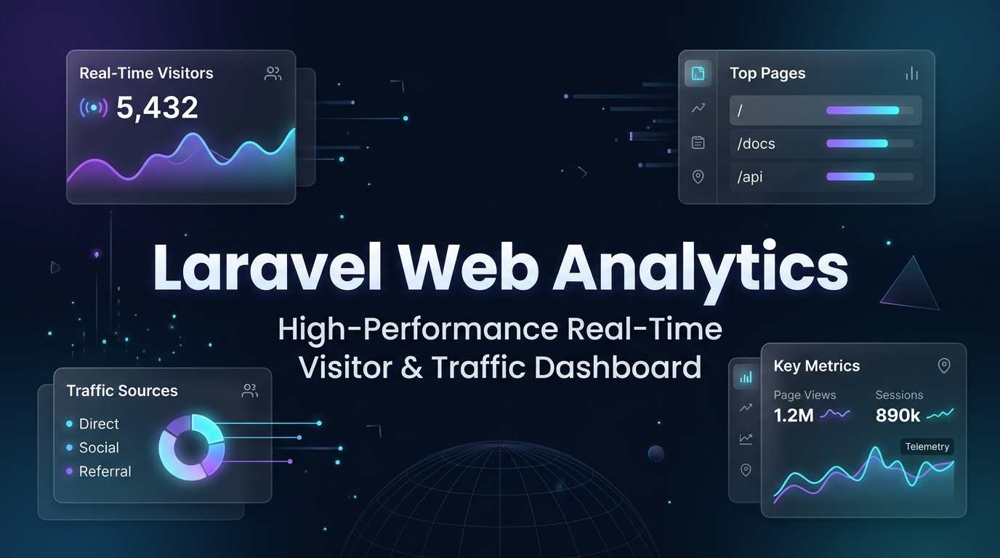

# Laravel Web Analytics

<p align="center">
  
</p>

<p align="center">
  <a href="https://packagist.org/packages/nafiur/laravel-web-analytics"></a>
  <a href="https://packagist.org/packages/nafiur/laravel-web-analytics"></a>
  <a href="https://github.com/nafiur/laravel-web-analytics/blob/main/LICENSE"></a>
</p>

A modern, fast, and self-hosted Web Traffic & Visitor Analytics Dashboard for Laravel with real-time Server-Sent Events (SSE) live streaming and Tailwind CSS styling.

---

## ⚡ Highlights & Key Features

- 🚀 **Real-Time Live Stream (SSE)**: Live active visitor count and instant real-time traffic feed without WebSockets, Node.js, or Pusher. Each stream response is short-lived and paced by EventSource, so no PHP worker is held open while waiting for new traffic.
- 🧭 **-Style Navigation**: Sidebar with Overview, Requests, Visitors, Performance, Live Stream and Setting. Each section has its own Blade view, and the Settings screen is hidden from the analytics tab bar.
- 🎨 **Tailwind CSS UI with Dark Mode**: Modern, responsive dashboard powered by Tailwind CSS Play CDN (zero build step / zero npm dependencies). Uses CSS design tokens (`--lwa-*`, `[data-theme="dark"]`), Lucide outline icons, visible focus states, skeleton loaders, explicit empty/error states, and a 1-click persistent Dark/Light/System preference.
- 📊 **Comprehensive Metrics**: Total Requests, Unique Visitors, Bandwidth (Data Transferred in GB/MB), Avg Response Time, Error Rate.
- 🧪 **Built-In Live Traffic Simulator**: Easily generate realistic live traffic every second with `php artisan lwa:live` to demo and test live streaming.
- 🌍 **GeoIP & Location Provider**: Automatic country/city resolution with fallback support for  headers and `ip-api`.
- 🚨 **Instant Error Alerts**: Telegram, Slack, or Discord webhook alerts on 5xx responses (deduplicated per URL/IP) and on error-rate spikes above a configurable threshold. Disabled by default.
- 📥 **Export to CSV**: Download filtered analytics logs into structured CSV format via high-performance chunked streams.
- 🧹 **Automatic Log Pruning**: Includes an Artisan command (`php artisan lwa:prune`) to maintain a clean database and prevent disk bloat.
- ⚡ **Post-Response Telemetry**: Tracking runs in Laravel's `terminate()` hook, after the HTTP response is sent. Optional GeoIP lookups and webhook alerts still occupy the worker for up to their configured timeouts (1s / 3s by default); keep alerts disabled unless needed.
- 🗄️ **Lightweight & Decoupled Storage**: Stores telemetry in the `lwa_logs` table without coupling to any specific User model, with GDPR-compliant IP anonymization options.
- 🔐 **Privacy-First Tracking**: Do Not Track support and an optional cookieless, daily-salted visitor fingerprint — no cookie banner required.
- 🎯 **UTM Campaigns**: `utm_source`, `utm_medium` and `utm_campaign` are captured automatically and shown in the Visitors tab.
- 🏳️ **Country Flags**: IP breakdowns and the live traffic feed show emoji flags resolved from the recorded country; the Settings language picker shows the active language flag.
- 🏢 **Multi-Tenancy Ready**: Native support for single-database multi-tenant applications (`stancl/tenancy`, `spatie/laravel-multitenancy`, or custom resolvers) with tenant-scoped dashboards and streams.

---

## 🚧 Advanced analytics schema (opt-in)

The advanced analytics data model is additive and disabled by default. Enable it only after reading the architecture blueprint:

```env
WEB_ANALYTICS_SCHEMA_ENABLED=true
WEB_ANALYTICS_WEBSITE_ID=1
WEB_ANALYTICS_COLLECTOR_MODE=sync   # or 'queue' once a worker is available
WEB_ANALYTICS_WRITE_LEGACY=true     # keep writing lwa_logs during migration
WEB_ANALYTICS_QUEUE=                # optional named queue
```

This creates separate `lwa_websites`, `lwa_visitors`, `lwa_sessions`, `lwa_pageviews`, `lwa_events`, hourly/daily rollup and upgrade-checkpoint tables. The legacy `lwa_logs` table is untouched by default (`WEB_ANALYTICS_WRITE_LEGACY=true`). When enabled, the middleware also feeds the collector, which resolves visitors/sessions with a 30-minute inactivity timeout and either writes inline (`sync`) or dispatches `RecordPageview` / `RecordEvent` jobs (`queue`). Custom event properties are validated and stripped of sensitive keys. Run `php artisan lwa:aggregate` (or schedule it hourly/daily) to build rollups; `MetricService` then answers KPI/chart queries from those rollups instead of scanning raw events.

Blueprint: `laravel-web-analytics-v3-blueprint.md` (on the planning desktop).

## 🎨 Design System

| Topic | Choice |
|-------|--------|
| UI Framework | Tailwind CSS (Play CDN — no build step) |
| Backend | Laravel Blade |
| Charts | ApexCharts |
| Icons | Lucide |
| Theme | Dark + Light (+ System), persisted in `localStorage` |
| Layout | Responsive (desktop / tablet / mobile) |
| Sidebar | Collapsible on desktop, off-canvas on mobile |
| Typography | Inter (with JetBrains Mono for numbers/codes) |
| Style | Modern restrained SaaS |

Theme colors are exposed as CSS custom properties (`--lwa-*`) with `[data-theme="dark"]`, so components do not duplicate color variants. The desktop sidebar collapse state is remembered across visits.

---

## 📋 Requirements

- PHP `^8.1 | ^8.2 | ^8.3 | ^8.4 | ^8.5`
- Laravel `^9.0 | ^10.0 | ^11.0 | ^12.0 | ^13.0`

---

## 📦 Installation

Install the package via Composer:

```bash
composer require nafiur/laravel-web-analytics
```

Publish configuration and (optionally) views:

```bash
php artisan vendor:publish --provider="Nafiur\WebAnalytics\WebAnalyticsServiceProvider"
```

Or publish selectively:

```bash
# Publish configuration
php artisan vendor:publish --tag=laravel-web-analytics-config

# Publish views (optional, to customize dashboard UI)
php artisan vendor:publish --tag=web-analytics-views
```

> **After upgrading the package:** published views override the package's own views. If you have published them and want the new UI changes, re-publish with `--force` and clear the compiled views:
>
> ```bash
> php artisan vendor:publish --tag=web-analytics-views --force
> php artisan view:clear
> ```
>
> If you do not customize the UI, simply delete `resources/views/vendor/web-analytics/` to always use the package views.

Migrations are auto-loaded by the service provider, so do **not** publish them — publishing would register the same migrations from two paths. Run database migrations to create the `lwa_logs` table:

```bash
php artisan migrate
```

---

## 🚀 Setup & Middleware Registration

To start capturing web traffic, register the `TrackWebTraffic` middleware.

### For Laravel 11, 12, and 13 (`bootstrap/app.php`):

```php
use Nafiur\WebAnalytics\Http\Middleware\TrackWebTraffic;

return Application::configure(basePath: dirname(__DIR__))
    ->withRouting(
        web: __DIR__.'/../routes/web.php',
        commands: __DIR__.'/../routes/console.php',
        health: '/up',
    )
    ->withMiddleware(function (Middleware $middleware) {
        $middleware->web(append: [
            TrackWebTraffic::class,
        ]);
    })
    ->create();
```

### For Laravel 9 and Laravel 10 (`app/Http/Kernel.php`):

Add the middleware to the `$middlewareGroups['web']` array:

```php
protected $middlewareGroups = [
    'web' => [
        // ... other middlewares
        \Nafiur\WebAnalytics\Http\Middleware\TrackWebTraffic::class,
    ],
];
```

---

## 🖥️ Accessing the Dashboard

Navigate to:

```
https://your-domain.com/web-analytics
```

By default, the dashboard is protected by the `['web', 'auth']` middleware stack. You can adjust the route prefix and authorization rules in `config/laravel-web-analytics.php`.

### Route Names

The package defines routes with the `lwa_` prefix to avoid conflicts with your application routes:

| Route | Name | Description |
|-------|------|-------------|
| `GET /web-analytics` | `lwa_dashboard` | Main analytics dashboard (alias: `lwa_index`) |
| `GET /web-analytics/data` | `lwa_data` | AJAX endpoint for real-time data |
| `GET /web-analytics/stream` | `lwa_stream` | SSE stream for live traffic |
| `GET /web-analytics/export` | `lwa_export` | Export analytics to CSV |
| `POST /web-analytics/settings/prune` | `lwa_settings_prune` | Prune rows older than N days |
| `POST /web-analytics/settings/empty` | `lwa_settings_empty` | Empty the telemetry table (requires `confirm=DELETE`) |
| `POST /web-analytics/settings/test-alert` | `lwa_settings_test_alert` | Send a test alert through the configured channel |

Every sidebar section also has its own bookmarkable URL:

| URL | Name | URL | Name |
|-----|------|-----|------|
| `/web-analytics/overview` | `lwa_overview` | `/web-analytics/campaigns` | `lwa_campaigns` |
| `/web-analytics/realtime` | `lwa_realtime` | `/web-analytics/events` | `lwa_events` |
| `/web-analytics/visitors` | `lwa_visitors` | `/web-analytics/conversions` | `lwa_conversions` |
| `/web-analytics/sources` | `lwa_sources` | `/web-analytics/performance` | `lwa_performance` |
| `/web-analytics/pages` | `lwa_pages` | `/web-analytics/errors` | `lwa_errors` |
| `/web-analytics/geography` | `lwa_geography` | `/web-analytics/settings` | `lwa_settings` |
| `/web-analytics/devices` | `lwa_devices` | | |

The legacy `/web-analytics` (`lwa_dashboard`) URL still works and shows the Overview pane. The Events and Conversions URLs render an explicit “not available yet” pane rather than fabricated numbers.

Generate URLs in your Blade templates or code:

```php
route('lwa_dashboard', ['range' => '24h']);
route('lwa_data', ['range' => '24h']);
route('lwa_stream');
route('lwa_export', ['range' => '24h']);
```

### Settings page

The dashboard's **Setting** tab provides an adapted settings screen:

- **General** — **12 languages** (English, বাংলা, हिन्दी, Español, Français, Deutsch, Português, العربية, 中文, 日本語, اردو, Indonesian — Arabic/Urdu switch the layout to RTL), the **complete IANA timezone database** (all PHP-supported zones), and appearance (System/Light/Dark). These are browser preferences stored in `localStorage`; no database changes are needed. The timezone is applied to live-feed timestamps and chart labels via `Intl.DateTimeFormat`.
- **Dashboard** — default time range, data source, compact numbers and keyboard shortcuts.
- **Collection** — read-only view of capture/GeoIP config.
- **Alerts** — read-only channel/threshold info and a **Send test alert** action.
- **Export** — default CSV range and whether to include the tenant scope in export links.
- **Data maintenance** — row counts and oldest/newest timestamps, plus **Prune** and **Empty table** actions. Both are POST routes behind the dashboard's middleware with CSRF protection; emptying requires typing `DELETE`, and in multi-tenant mode only the current tenant's rows are removed.
- **About** — package/runtime information.

Set `WEB_ANALYTICS_DESTRUCTIVE_ACTIONS=false` to disable the prune/empty actions entirely.

### Data source & client IP

By default the dashboard reads the `lwa_logs` database table. The **Data source** selector can switch to `?source=file`, which parses a web-server access log from `WEB_ANALYTICS_SERVER_LOG_PATH` (or a detected default path). Configure `WEB_ANALYTICS_MAX_LINES` to bound how much of the file is read.

The header's refresh button reloads the current report through `lwa_data` and shows a retry toast on failure. The Live Stream tab displays its SSE connection state (connected / reconnecting / disconnected) with a manual retry action.

Client IP resolution uses Laravel's trusted-proxy configuration. Only enable `WEB_ANALYTICS_TRUST_FORWARDED_HEADERS=true` if the immediate peer is a trusted reverse proxy; otherwise `CF-Connecting-IP` / `X-Forwarded-For` can be spoofed by clients.

---

## 🧩 View structure

Each sidebar route renders its own Blade page; no section is a hidden tab inside another page:

```text
resources/views/
├── layouts/app.blade.php          # shared shell (head, header, sidebar, subheader, scripts)
├── pages/                         # one Blade file per route
│   ├── overview.blade.php         ├── sources.blade.php      ├── devices.blade.php
│   ├── realtime.blade.php         ├── pages.blade.php        ├── campaigns.blade.php
│   ├── visitors.blade.php         ├── geography.blade.php    ├── performance.blade.php
│   ├── events.blade.php           ├── conversions.blade.php  ├── errors.blade.php
│   └── settings.blade.php
├── sections/                      # content-only partials included by the pages
└── partials/                      # header, sidebar, subheader, scripts, breakdown list
```

The legacy `dashboard.blade.php` simply extends the shared layout and renders the Overview section.

## 🧭 Dashboard Navigation

The sidebar exposes 13 sections. Items map to report panes (or scroll to a specific report on the same page) — no extra routes are required:

| Menu item | Shows |
|-----------|-------|
| **Overview** | KPI cards, traffic chart, top pages, sources, countries, devices |
| **Real-time** | Live SSE traffic feed and active visitors |
| **Visitors** | Unique visitors, IPs, geography, devices, browsers |
| **Traffic Sources** | Referrers / UTM sources (scrolls to Top referrers) |
| **Pages & Screens** | Top paths (scrolls to Top paths) |
| **Geography** | Top countries (scrolls to Countries) |
| **Devices & Browsers** | Device / OS / browser breakdowns |
| **Campaigns** | UTM source / medium / campaign breakdowns |
| **Events & Goals** | Unavailable — requires a custom event collector |
| **Conversions** | Unavailable — requires configured goals |
| **Performance** | Latency, response times, bandwidth by path |
| **Error Monitoring** | 4xx/5xx errors, slow/error paths |
| **Settings** | Preferences, maintenance, alerts, about |

> **No fabricated analytics:** Events & Goals and Conversions are intentionally shown as unavailable until an event collector exists. All other derived metrics use explicit definitions:
>
> - **Total Visitors** — distinct IP addresses in the range (privacy-preserving device proxy)
> - **Unique Visitors** — distinct `session_id` (IP fallback)
> - **Pageviews** — GET requests to non-API paths
> - **Sessions** — distinct visitor session identifiers
> - **Bounce Rate** — sessions with exactly one recorded request
> - **Avg Engagement Time** — average time between first and last request in a session |

### Time Range Filtering
Select from predefined or custom time ranges via the segmented dropdown:
- **`1h`**: Last hour with hourly breakdown.
- **`6h`** / **`12h`**: Last 6 or 12 hours.
- **`24h`** (Default): Last 24 hours with clean hourly breakdown.
- **`today`**: Today from midnight to current time.
- **`7d`**: Last 7 days with daily trends.
- **`30d`**: Last 30 days historical telemetry.
- **`all`**: Complete all-time records.
- **`custom`**: Choose custom `start_date` and `end_date` from the dashboard's range menu.

Empty periods are zero-filled in charts so time gaps stay visible.

---

## 🧪 Live Traffic Simulation & Demo Testing

Laravel Web Analytics includes a built-in Artisan simulator to generate realistic live web traffic every second. This allows you to demo and test the real-time SSE stream, live counters, and dashboard charts immediately:

```bash
# Start simulating live traffic (2 requests/sec, runs continuously)
php artisan lwa:live

# Custom requests per second (e.g. 5 req/sec)
php artisan lwa:live --rps=5

# Custom delay interval between batches (e.g. every 2 seconds)
php artisan lwa:live --interval=2

# Run for a specific number of seconds then exit (e.g. 60 seconds)
php artisan lwa:live --count=60

# Tag traffic with a specific tenant ID for multi-tenant testing
php artisan lwa:live --tenant=company-xyz
```

> **Tip:** Open the dashboard in your browser (`/web-analytics`), switch to the **Live Stream** tab, and run `php artisan lwa:live` in your terminal to watch requests flow in live second by second!

---

## ⚙️ Configuration (`config/laravel-web-analytics.php`)

```php
return [
    /*
     * Enable or disable traffic tracking globally
     */
    'enabled' => env('WEB_ANALYTICS_ENABLED', true),

    /*
     * Database table name for storing web analytics logs
     */
    'table_name' => env('WEB_ANALYTICS_TABLE_NAME', 'lwa_logs'),

    /*
     * Optional server access-log fallback (used by ?source=file)
     */
    'server_log_path' => env('WEB_ANALYTICS_SERVER_LOG_PATH', null),
    'max_lines'       => env('WEB_ANALYTICS_MAX_LINES', 50000),

    /*
     * Route configurations for the Analytics Dashboard
     */
    'route' => [
        'prefix'     => env('WEB_ANALYTICS_ROUTE_PREFIX', 'web-analytics'),
        'middleware' => ['web', 'auth'],
    ],

    /*
     * Real-time SSE polling interval in seconds
     */
    'stream_interval' => env('WEB_ANALYTICS_STREAM_INTERVAL', 2),

    'stream' => [
        'mode'               => env('WEB_ANALYTICS_STREAM_MODE', 'sse'), // 'sse' | 'polling'
        'polling_interval'   => env('WEB_ANALYTICS_POLLING_INTERVAL', 5),
        'max_execution_time' => env('WEB_ANALYTICS_STREAM_MAX_EXECUTION_TIME', 0),
    ],

    /*
     * Active visitor calculation window in minutes
     */
    'active_visitor_window' => env('WEB_ANALYTICS_ACTIVE_WINDOW', 5),

    /*
     * Capture Settings (Web & API)
     */
    'capture' => [
        'web'                     => env('WEB_ANALYTICS_CAPTURE_WEB', true),
        'api'                     => env('WEB_ANALYTICS_CAPTURE_API', true),
        'ajax'                    => env('WEB_ANALYTICS_CAPTURE_AJAX', true),
        'bots'                    => env('WEB_ANALYTICS_CAPTURE_BOTS', false), // false | true | 'known'
        'trust_forwarded_headers' => env('WEB_ANALYTICS_TRUST_FORWARDED_HEADERS', false),
    ],

    'privacy' => [
        'respect_dnt'         => env('WEB_ANALYTICS_RESPECT_DNT', true),
        'visitor_id_strategy' => env('WEB_ANALYTICS_VISITOR_ID_STRATEGY', 'session'), // 'session' | 'fingerprint'
        'fingerprint_salt'    => env('WEB_ANALYTICS_FINGERPRINT_SALT', ''),
    ],

    /*
     * GeoIP & Location Provider
     */
    'geoip' => [
        'enabled'  => env('WEB_ANALYTICS_GEOIP_ENABLED', true),
        'provider'        => env('WEB_ANALYTICS_GEOIP_PROVIDER', ''), // '', 'ip-api', 'maxmind'
        'timeout'         => env('WEB_ANALYTICS_GEOIP_TIMEOUT', 1),
        'maxmind_db_path' => env('WEB_ANALYTICS_MAXMIND_DB', storage_path('app/GeoLite2-City.mmdb')),
    ],

    /*
     * Alert Notifications (Spikes & 5xx Server Errors)
     */
    'alerts' => [
        'enabled'                         => env('WEB_ANALYTICS_ALERTS_ENABLED', false),
        'webhook_url'                     => env('WEB_ANALYTICS_ALERT_WEBHOOK', null),
        'channel'                         => env('WEB_ANALYTICS_ALERT_CHANNEL', 'telegram'), // 'telegram', 'slack', 'discord'
        'telegram_bot_token'              => env('WEB_ANALYTICS_TELEGRAM_BOT_TOKEN', null),
        'telegram_chat_id'                => env('WEB_ANALYTICS_TELEGRAM_CHAT_ID', null),
        'email'                           => env('WEB_ANALYTICS_ALERT_EMAIL', null), // weekly summary recipient
        'error_rate_threshold_percentage' => env('WEB_ANALYTICS_ERROR_THRESHOLD', 10),
    ],

    /*
     * Exclude specific URL paths and file extensions from being tracked
     */
    'ignored_paths' => [
        'livewire/*',
        'broadcasting/auth',
        'admin/web-analytics*',
        '*.css',
        '*.js',
        '*.png',
        '*.jpg',
        '*.jpeg',
        '*.gif',
        '*.svg',
        '*.webp',
        '*.woff*',
        '*.ico',
    ],

    /*
     * IP Anonymization for privacy compliance (GDPR)
     */
    'anonymize_ip' => env('WEB_ANALYTICS_ANONYMIZE_IP', false),

    /*
     * Number of days to retain logs
     */
    'retention_days' => env('WEB_ANALYTICS_RETENTION_DAYS', 30),

    'settings' => [
        'destructive_actions_enabled' => env('WEB_ANALYTICS_DESTRUCTIVE_ACTIONS', true),
    ],

    /*
     * Multi-Tenancy Support
     */
    'multi_tenancy' => [
        'enabled'                    => env('WEB_ANALYTICS_MULTI_TENANCY', false),
        'tenant_resolver'            => null, // Auto-detects stancl, spatie, or auth user
        'tenant_override_authorizer' => null, // Opt-in cross-tenant dashboard access
    ],
];
```

---

## 🔐 Privacy & bot filtering

- **Do Not Track:** with `WEB_ANALYTICS_RESPECT_DNT=true` (default), requests carrying `DNT: 1` are never logged.
- **Cookieless visitors:** set `WEB_ANALYTICS_VISITOR_ID_STRATEGY=fingerprint` to identify guests with `sha256(IP|User-Agent|date|salt)` instead of the Laravel session id. Always set `WEB_ANALYTICS_FINGERPRINT_SALT` to a stable random value; otherwise the app key is used as a fallback.
- **Bot filtering:** `WEB_ANALYTICS_CAPTURE_BOTS` accepts `false` (skip all bots — default), `true` (capture everything), or `known` (capture recognised search-engine/social crawlers but skip scrapers and CLI tooling).

## 🗺️ Offline GeoIP & live map

The Real-time page includes a vector world map. Set:

```env
WEB_ANALYTICS_GEOIP_PROVIDER=maxmind
WEB_ANALYTICS_MAXMIND_DB=/absolute/path/to/GeoLite2-City.mmdb
composer require maxmind-db/reader
```

Lookups then happen **locally** with no external API call; country, city and coordinates are cached per IP and plotted on the live map. Without the optional reader/database, the package degrades gracefully and the map explains what is missing. The map library ships its own world shape data, so no map tile API is called either.

## 📡 SSE limits & polling fallback

Each stream response is short-lived and paced by EventSource `retry` plus `Last-Event-ID`. For shared hosting with very few PHP workers:

```env
WEB_ANALYTICS_STREAM_MODE=polling
WEB_ANALYTICS_POLLING_INTERVAL=5
WEB_ANALYTICS_STREAM_MAX_EXECUTION_TIME=15
```

`polling` uses ordinary `fetch()` calls instead of a persistent connection; `max_execution_time` caps a single stream response with `set_time_limit()` (0 leaves PHP's setting untouched). The connection badge reports Connected / Reconnecting / Disconnected / Polling and offers a manual retry.

## 🧹 Database Maintenance (Pruning)

> Upgrading from an earlier release: `user_id` is now a nullable string column (up to 64 chars) so UUID / string user keys are supported. Existing installs must alter the column manually if they store non-integer identifiers. A migration also adds `utm_source`, `utm_medium` and `utm_campaign`.

To keep your database lean, run the included prune command:

```bash
# Prune logs older than configured retention days (default 30)
php artisan lwa:prune

# Or specify custom days
php artisan lwa:prune --days=14
```

Schedule it in your `routes/console.php` (Laravel 11+) or `app/Console/Kernel.php`:

```php
use Illuminate\Support\Facades\Schedule;

Schedule::command('lwa:prune')->daily();
Schedule::command('lwa:summary')->weekly(); // sends a digest if alerts are enabled
```

Every command also has an `analytics:` alias (`analytics:prune`, `analytics:export`, `analytics:summary`).

### CLI export

```bash
php artisan lwa:export --format=csv --range=7d --output=storage/app/analytics.csv
php artisan analytics:export --range=all --tenant=company-xyz
```

---

## 📥 Exporting Reports

Click the **Export to CSV** button on the dashboard or directly access:

```
GET /web-analytics/export?range=24h
```

Supported ranges: `1h`, `6h`, `12h`, `24h`, `today`, `7d`, `30d`, `all`, `custom` (with `start_date` / `end_date`).

---

## 🛡️ Security & Authorization

To restrict dashboard access to specific user roles or permissions, update `config/laravel-web-analytics.php`:

```php
'route' => [
    'prefix'     => 'web-analytics',
    'middleware' => ['web', 'auth', 'can:view-analytics'],
],
```

---

## 🏢 Multi-Tenancy Support

Laravel Web Analytics supports multi-tenant applications (both Single-Database with `tenant_id` and Multi-Database setups).

### 1. Enable in `.env` or `config/laravel-web-analytics.php`

```env
WEB_ANALYTICS_MULTI_TENANCY=true
```

### 2. Auto-Detection Out of the Box
When enabled, the package automatically detects active tenants from:
- **[stancl/tenancy](https://tenancyforlaravel.com/)**: `tenant('id')`
- **[spatie/laravel-multitenancy](https://spatie.be/docs/laravel-multitenancy)**: `Tenant::current()?->id`
- **Authenticated User**: `auth()->user()?->tenant_id` or `auth()->user()?->tenant?->id`
- **Session / Request**: session keys or `X-Tenant-ID` header (telemetry tagging only — see below)

### 3. Dashboard Tenant Scoping (Security)

Dashboard routes (`lwa_dashboard`, `lwa_data`, `lwa_stream`, `lwa_export` and the `lwa_settings_*` actions) **ignore** `?tenant_id=` and `X-Tenant-ID` by default. They only use tenant IDs resolved from trusted server-side context, so a user cannot view another tenant's analytics by editing the URL.

For admin dashboards that legitimately need cross-tenant views, opt in with an authorizer callback that returns `true` only when the current user is allowed:

```php
'multi_tenancy' => [
    'enabled'                    => true,
    'tenant_resolver'            => null,
    'tenant_override_authorizer' => fn ($requested, $resolved, $request) =>
        $request->user()?->is_admin === true,
],
```

The request value is accepted only when the callback returns exactly `true`; errors fail closed.

### 4. Custom Tenant Resolver
You can define a custom resolver callback in `config/laravel-web-analytics.php`:

```php
'multi_tenancy' => [
    'enabled'         => env('WEB_ANALYTICS_MULTI_TENANCY', false),
    'tenant_resolver' => function ($request) {
        return session('current_tenant_uuid');
    },
],
```

### 5. Tenant-Scoped Pruning
Prune logs for a specific tenant:

```bash
php artisan lwa:prune --days=30 --tenant=tenant-uuid
```

---

## 🛠 Artisan Commands

| Command | Alias | Description |
|---------|-------|-------------|
| `lwa:prune` | `analytics:prune` | Delete logs older than the retention window (`--days`, `--tenant`) |
| `lwa:export` | `analytics:export` | Export CSV (`--range`, `--tenant`, `--output`) |
| `lwa:summary` | `analytics:summary` | Print the periodic digest and send it if alerts are enabled |
| `lwa:aggregate` | — | Build hourly/daily rollups from raw events (`--website`, `--from`, `--to`, `--granularity`) |
| `lwa:live` | — | Generate simulated live traffic for demos (`--rps`, `--interval`, `--count`, `--tenant`) |

---

## 🧪 Testing

```bash
composer install
vendor/bin/phpunit
```

The suite uses Orchestra Testbench. Locally it defaults to an in-memory SQLite database (`pdo_sqlite` required). CI runs the same suite against **SQLite, MySQL 8 and PostgreSQL 16** through service containers; set `DB_CONNECTION`, `DB_HOST`, `DB_PORT`, `DB_DATABASE`, `DB_USERNAME` and `DB_PASSWORD` to run it against another database locally.

---

## 🤝 Contributing

Contributions, issues, and feature requests are welcome! Feel free to check the [issues page](https://github.com/nafiur/laravel-web-analytics/issues).

---

## 📝 License

This project is licensed under the MIT License - see the [LICENSE](LICENSE) file for details.